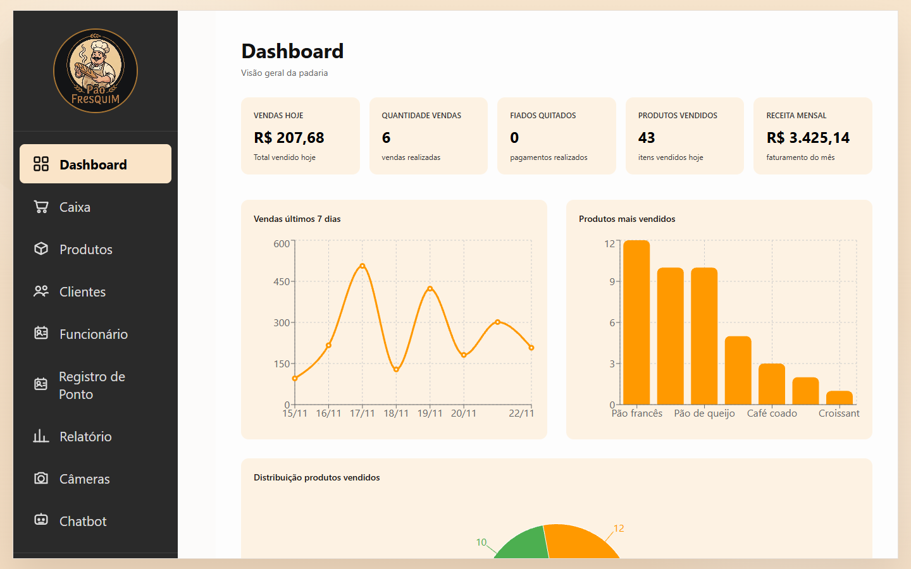
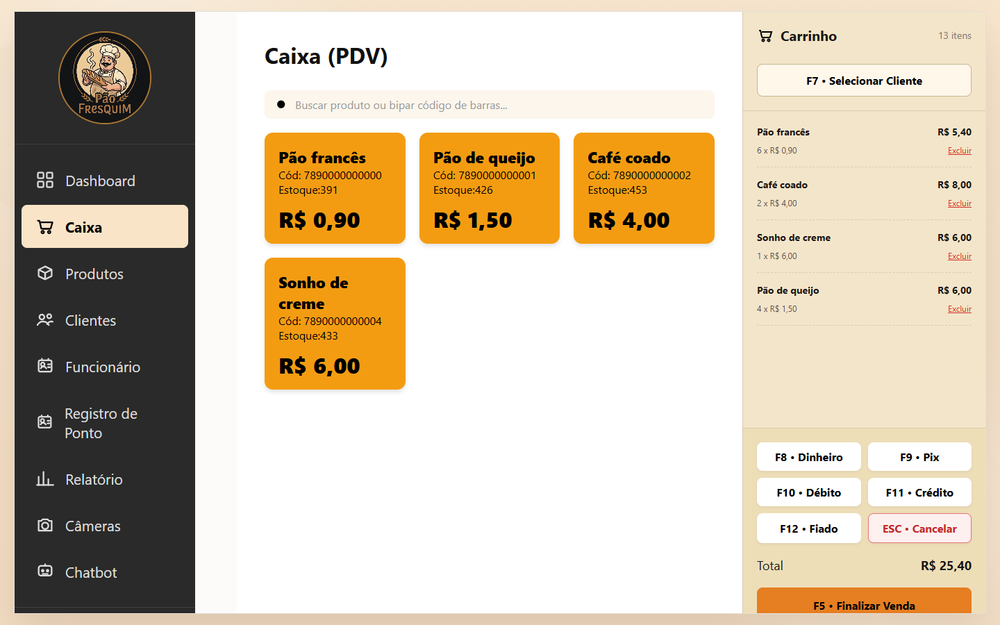
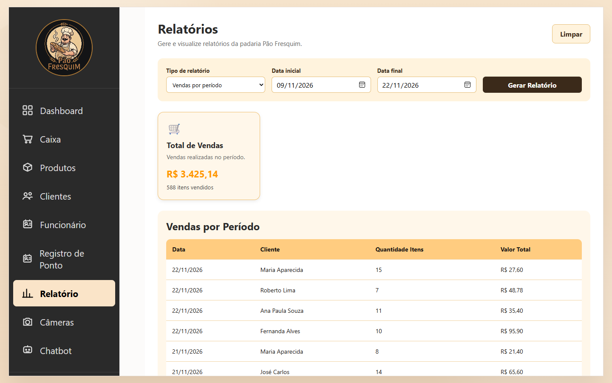
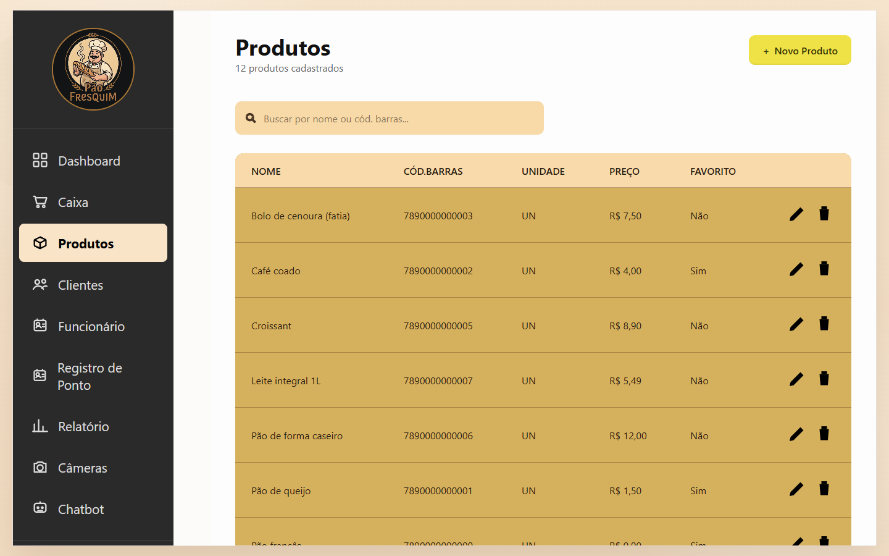
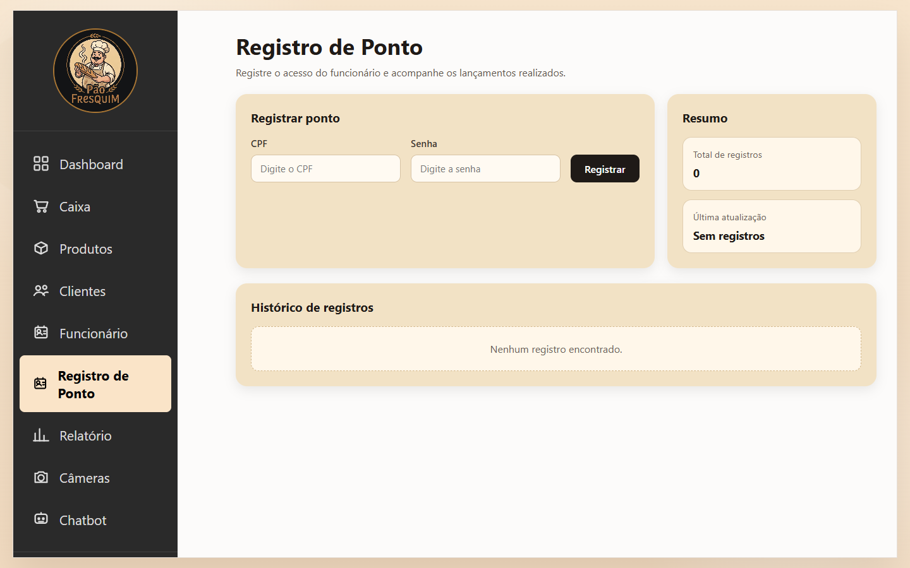
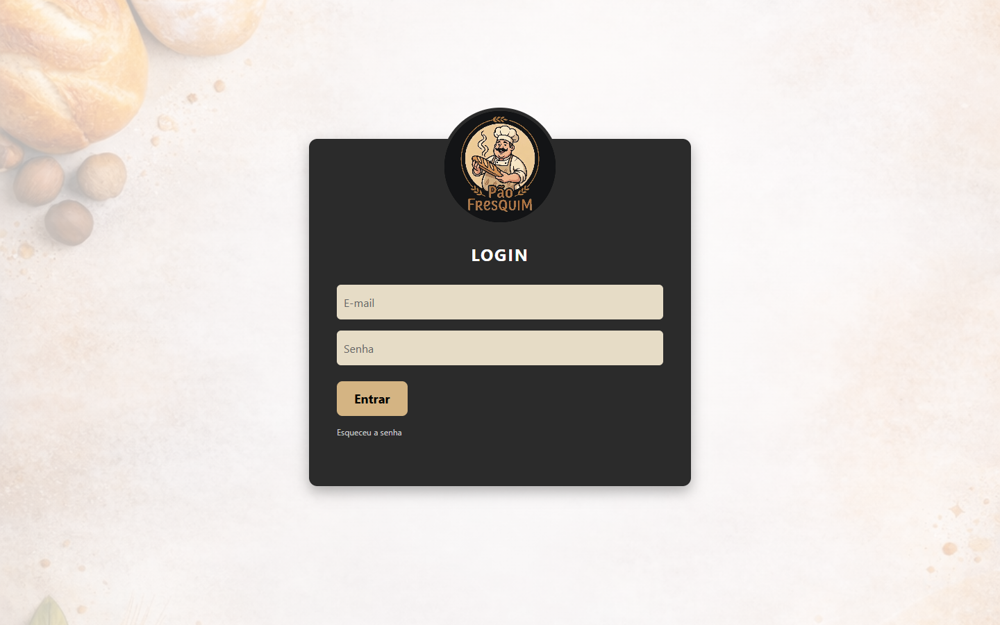

<div align="center">

# Pão Fresquim · Front-end

Sistema de gestão para padaria: caixa (PDV), estoque, clientes com venda fiado, funcionários, registro de ponto, relatórios e dashboard.
Este repositório é a interface em **React**. A API em Spring Boot está em **[paofresquim-backend](https://github.com/opedroasa/paofresquim-backend)**.




</div>

## Contexto

Projeto **interdisciplinar do 7º período de Sistemas de Informação** (Anhanguera, 2026). A proposta original era fazer um trabalho separado para cada disciplina, mas a turma sugeriu aos professores unificar tudo em **um único sistema completo**, atendendo ao mesmo tempo **Programação Web II**, **Projeto de Sistemas**, **Desenvolvimento em JavaScript** e **Desenvolvimento de Chatbot**.

O sistema tem três partes: [front-end](https://github.com/opedroasa/paofresquim-frontend) (React), [API](https://github.com/opedroasa/paofresquim-backend) (Spring Boot) e um chatbot de atendimento feito em **n8n**. O time trabalhou com metodologia ágil (Trello + GitHub) e entregou uma **documentação completa de ponta a ponta** (PDF na raiz deste repositório).

## Funcionalidades

| Tela | O que faz |
|---|---|
| **Caixa (PDV)** | Busca por nome ou leitor de código de barras, carrinho, escolha do cliente e pagamento em dinheiro (com cálculo de troco), Pix, débito, crédito ou fiado, tudo com **atalhos de teclado** (F5 a F12, ESC) |
| **Dashboard** | Vendas do dia, faturamento do mês, gráfico dos últimos 7 dias, produtos mais vendidos e distribuição das vendas |
| **Relatórios** | Vendas por período, produtos mais vendidos e clientes com fiado em aberto, com filtros de data |
| **Produtos e estoque** | Cadastro com código de barras, unidade de medida e favoritos (que aparecem no caixa) |
| **Clientes** | Cadastro com endereço e controle de crédito para venda fiado |
| **Funcionários e ponto** | Cadastro de funcionários e registro de ponto por CPF e senha |

## Telas

<table>
  <tr>
    <td width="50%"><br><sub><b>Caixa (PDV):</b> produtos favoritos, carrinho e formas de pagamento com atalhos de teclado.</sub></td>
    <td width="50%"><br><sub><b>Relatórios:</b> vendas por período com total e itens vendidos.</sub></td>
  </tr>
  <tr>
    <td><br><sub><b>Produtos:</b> busca por nome ou código de barras.</sub></td>
    <td><br><sub><b>Registro de ponto</b> dos funcionários.</sub></td>
  </tr>
</table>

<p align="center"></p>

## Stack e organização

- **React 19 + Vite**, **React Router** para as rotas e **Axios** para falar com a API
- **Recharts** nos gráficos do dashboard e dos relatórios, e **React Toastify** nas notificações

```
src/
  pages/        uma página por módulo (Caixa, Dashboard, Relatorio, produto, Cliente, Funcionario, Ponto…)
  components/   componentes por módulo (caixa/, produto/, relatorio/, funcionario/…) e layout (menu lateral)
  services/     chamadas à API, uma por recurso (vendaService, produtoService, relatorioService…)
  routes/       rotas da aplicação
```

## Rodando localmente

Precisa da [API](https://github.com/opedroasa/paofresquim-backend) rodando em `http://localhost:8080`.

```bash
npm install
npm run dev
```

O site abre em `http://localhost:5173`.

## Equipe

Time do repositório:
Pedro Alexandre ([@opedroasa](https://github.com/opedroasa)) · Pedro Henrique Pereira ([@pedrohs-pereira](https://github.com/pedrohs-pereira)) · Alexandre Barcelos ([@Xand9](https://github.com/Xand9)) · Vinicius Umberto ([@ViniciusUmberto](https://github.com/ViniciusUmberto)) · Henrique Coelho ([@HcoelhoSev](https://github.com/HcoelhoSev))

**Minha parte (Pedro Alexandre):** atuei como **gerente de projeto**, definindo e distribuindo as tarefas, acompanhando as entregas e alinhando as equipes, e também desenvolvi. Fiz de ponta a ponta, no front e na API, o **Caixa (PDV)**, os **Relatórios** e o **Dashboard**, além da tela de Funcionários no front.

Turma completa do projeto: Pedro Alexandre, Beatriz Andrade, Henrique Coelho, Ugo Lima, Vinícius Umberto, Ana Júlia, Alexandre Barcelos, Maiky Silva e Pedro Henrique Pereira.
